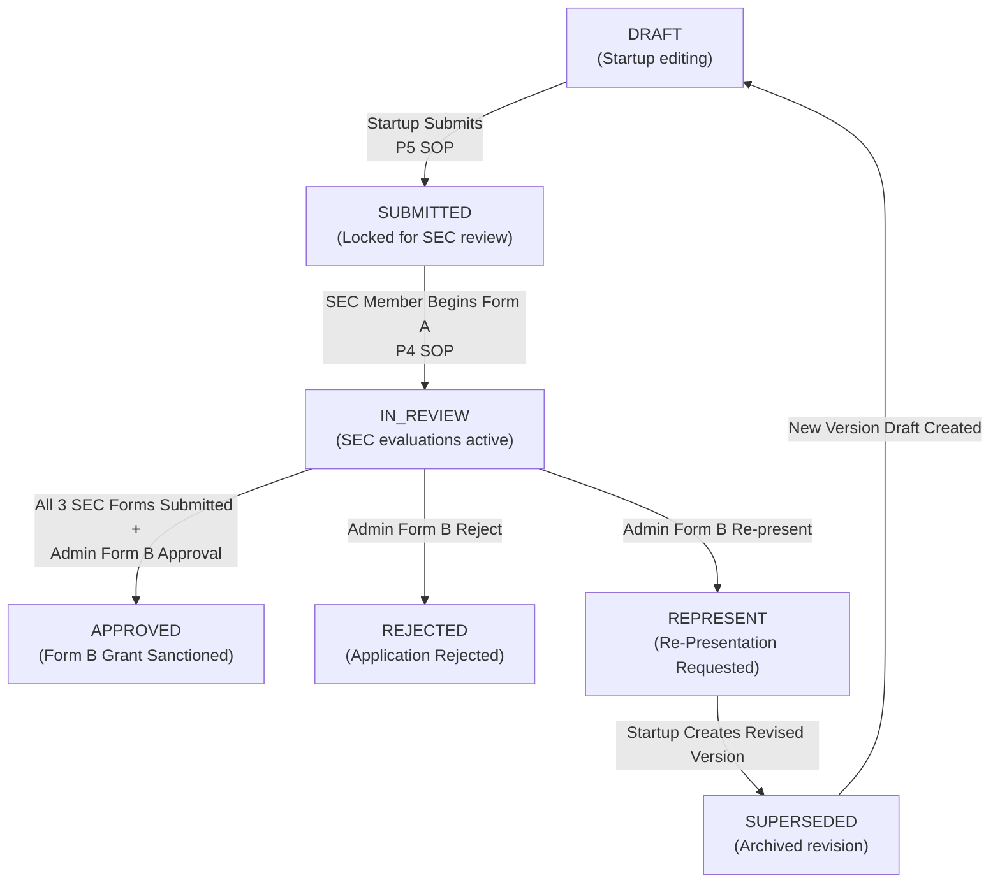
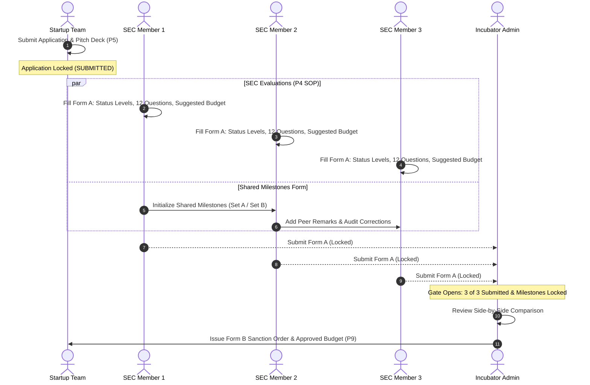

# IDEAPAD Seed Fund Portal: System Architecture & Logic Manual

This document explains the end-to-end operation, security model, and lifecycle rules of the IDEAPAD Seed Fund Portal. It is written for non-developers, specifically the ERP Cell, incubation center leadership, and university administration.

Every explanation in this document is verified against and maps directly to the implementation source files.

---

## 1. System Roles & Access Permissions

The portal supports three distinct authenticated roles defined in the database enum `Role` in [`prisma/schema.prisma`](file:///home/ec2-user/SEED_FUND/prisma/schema.prisma#L10) and enforced in route middleware [`src/middleware.ts`](file:///home/ec2-user/SEED_FUND/src/middleware.ts#L12) and access control [`src/lib/access.ts`](file:///home/ec2-user/SEED_FUND/src/lib/access.ts#L12):

1. **STARTUP (Student / Founder Applicant):**
   - **Registration:** Open public registration at `/register`. Registers student name, university enrollment number, academic program, department, phone number, and startup team name. Handled in [`src/lib/auth-actions.ts:register()`](file:///home/ec2-user/SEED_FUND/src/lib/auth-actions.ts#L65).
   - **Workspace:** `/dashboard` and `/dashboard/apply`. Can draft, edit, and submit seed fund applications.
   - **Access Boundaries:** Enforced by [`src/lib/access.ts:applicationScope()`](file:///home/ec2-user/SEED_FUND/src/lib/access.ts#L27). A startup user can **only view and edit applications belonging to their own user account**. Attempting to access another team's application results in an HTTP 404 (masking existence).

2. **SEC_MEMBER (Startup Evaluation Committee Panelist):**
   - **Registration & Approval Gate:** SEC candidates submit registration at `/sec-register` specifying their academic designation and department. Handled in [`src/lib/auth-actions.ts:registerSec()`](file:///home/ec2-user/SEED_FUND/src/lib/auth-actions.ts#L143).
   - **Pending Status:** Accounts are created with `approvalStatus = 'PENDING'` and `active = false`. The login route in [`src/lib/auth-actions.ts:login()`](file:///home/ec2-user/SEED_FUND/src/lib/auth-actions.ts#L36) actively rejects unverified SEC members with a clear notice until an Administrator approves their profile.
   - **Workspace:** `/sec` (evaluator dashboard) and `/sec/[id]` (split-view Form A evaluation console).
   - **Access Boundaries:** Can review all submitted applications (`SUBMITTED`, `IN_REVIEW`, `APPROVED`, `REJECTED`, `REPRESENT`). Cannot view draft applications. Evaluators fill out Form A independently; each evaluator's form is isolated until submission.

3. **ADMIN (IDEAPAD Incubator Management / Director):**
   - **Creation:** Seeded via environment variables (`ADMIN_EMAIL`, `ADMIN_PASSWORD`) using [`prisma/seed.ts`](file:///home/ec2-user/SEED_FUND/prisma/seed.ts).
   - **Workspace:** `/admin` and `/admin/application/[id]`.
   - **Authority:** Approves or rejects SEC evaluator registrations (`adminApproveSecUser`, `adminRejectSecUser`), monitors application pipelines, compares all 3 SEC evaluations side-by-side, and issues the binding Form B Grant Sanction Order.

---

## 2. End-to-End Application Lifecycle & Status Flow

The portal enforces a strict finite-state machine defined by the `AppStatus` enum in [`prisma/schema.prisma`](file:///home/ec2-user/SEED_FUND/prisma/schema.prisma#L16):

### Detailed State Transitions & Triggers

1. **`DRAFT` (Initial State):**
   - **Who triggers:** Startup clicks "Start New Application" in [`src/lib/access.ts:createDraft()`](file:///home/ec2-user/SEED_FUND/src/lib/access.ts#L102).
   - **Editing:** Startup can save partial drafts, modify the 10 experiment fields, add/edit budget items, upload KYC documents, and update milestones.
   - **Lock status:** Unlocked for the startup. Invisible to SEC evaluators.

2. **`SUBMITTED`:**
   - **Who triggers:** Startup completes all 8 wizard sections, accepts the legal declaration, and clicks "Submit Application" in [`src/app/(startup)/dashboard/apply/ApplicationWizard.tsx:handleFinalSubmit()`](file:///home/ec2-user/SEED_FUND/src/app/(startup)/dashboard/apply/ApplicationWizard.tsx#L630) via [`src/lib/access.ts:submitApplication()`](file:///home/ec2-user/SEED_FUND/src/lib/access.ts#L380).
   - **Lock status:** The startup application is **permanently locked (read-only)** for the applicant. It becomes visible on SEC and Admin dashboards.

3. **`IN_REVIEW`:**
   - **Who triggers:** Transition occurs automatically when any approved SEC evaluator saves or claims a section on Form A in [`src/lib/access.ts:saveAssessment()`](file:///home/ec2-user/SEED_FUND/src/lib/access.ts#L619).
   - **Lock status:** SEC members actively evaluate the startup in split view. Form B final decision remains locked behind the readiness gate.

4. **`APPROVED` / `REJECTED` / `REPRESENT`:**
   - **Who triggers:** Administrator issues Form B sanction order in [`src/app/(admin)/admin/application/[id]/actions.ts:submitAdminFormBAction()`](file:///home/ec2-user/SEED_FUND/src/app/(admin)/admin/application/[id]/actions.ts#L10) via [`src/lib/access.ts:submitFormB()`](file:///home/ec2-user/SEED_FUND/src/lib/access.ts#L710).
   - **Lock status:** Form B is locked. All individual SEC Form A assessments are locked. Printable versions of Form A and Form B become final official audit records.

---

## 3. How the Three SEC Assessments Combine (Form A to Form B)

Policy clauses P3, P4, and P8 establish a Startup Evaluation Committee consisting of three experts covering: (1) innovation and product development, (2) business and finance, and (3) market access.

Here is how their individual evaluations are synthesized by the system:

1. **Status Assessment (TRL, MRL, IRL 1–9):**
   - Each SEC member independently selects the achieved levels based on the startup's live pitch presentation.
   - The Admin comparison table [`src/components/admin/AdminFormB.tsx`](file:///home/ec2-user/SEED_FUND/src/components/admin/AdminFormB.tsx#L270) displays all three evaluations side by side (e.g. M1: TRL 3, M2: TRL 3, M3: TRL 2) to identify consensus or divergence.

2. **Shared Milestone Form (Form A Part 2):**
   - There is **exactly ONE shared milestone form per application**, initialized by whichever member starts the milestone evaluation (`claimMilestoneAction`).
   - The initial member sets the track (Idea Prototyping vs Professional Practice) and records item states (`COMPLETED`, `PENDING`, `IN_PROGRESS`).
   - All three members can add peer remarks on individual milestone items.
   - Any state change after initial creation triggers a log entry in `MilestoneEditLog` [`src/app/(sec)/sec/[id]/actions.ts:updateMilestoneStateAction()`](file:///home/ec2-user/SEED_FUND/src/app/(sec)/sec/[id]/actions.ts#L75). This log is printed on Form A, satisfying the policy requirement that corrections require signed documentation.

3. **12 Experiment Assessment Questions:**
   - Evaluators vote `YES` or `NO` on each of the 12 policy questions across Technical Soundness (1–7), Market Worthiness (8–10), and Execution Readiness (11–12).
   - An automated decision guide banner computes `YES` and `NO` counts in real time: `>= 9 YES` indicates "Recommend Funding (TRL-3 likely)"; `>= 4 NO` indicates "Revision Required".
   - Each member documents question notes referencing specific numbers for university audit records.

4. **Budget Moderation under Annexure 1:**
   - Evaluators suggest moderated grant allocations under each of the 9 headers (Equipment, Consumables, Software, Manpower, Travel, Testing, Services, Outreach, Contingency).
   - When the Admin opens Form B, the system auto-calculates the arithmetic average suggested by the SEC members for each header as a sensible baseline.

---

## 4. The Admin's Form B & Sanction Order

Policy clause P9 mandates the creation of Form B ("Grant Evaluation Report by Startup Evaluation Committee, filled in by IDEAPAD"):

1. **Readiness Gate Enforcement:**
   - In [`src/lib/access.ts:formBReadiness()`](file:///home/ec2-user/SEED_FUND/src/lib/access.ts#L687), the system checks that **every active approved SEC member has submitted their Form A** and that the **shared milestone form is submitted**. If these conditions are not met, the gate is locked.
2. **Approved Budget Formulation:**
   - Admin sets the approved amount under each of the 9 Annexure 1 headers. The total is calculated automatically.
3. **Approved Timeline (8 Binding Dates):**
   - Captures the 8 governance milestones:
     1. Grant Approval Date
     2. Fund Release Date
     3. Experiment Duration (e.g., 4 to 6 months from fund release)
     4. Mid-Review Date
     5. Grant Utilization Deadline
     6. Experiment Completion Date (TRL-3 PoC demo deadline)
     7. Final Submission Date (report, UC, demo evidence)
     8. Closure Date (grant closure required to unlock future eligibility)
   - Stored in UTC, displayed strictly in `Asia/Kolkata` (IST) without date shifts.
4. **Institutional Signatories Block:**
   - Form B dynamically renders names, designations, and departments for the 5 official institutional signatories:
     1. Vice Chancellor, ITM University Gwalior
     2. Dean / HoD of the applicant's school or department
     3. Director, IDEAPAD (Ashish Singh Chandel)
     4. Assistant Director, Startups (Arun Singh Kushwah)
     5. SEC Member (Ambar Agarwal)
   - Dynamic profile resolution in [`src/app/(admin)/admin/application/[id]/page.tsx`](file:///home/ec2-user/SEED_FUND/src/app/(admin)/admin/application/[id]/page.tsx#L25) ensures profiles are never hardcoded.

---

## 5. Form Locking & Data Integrity Rules

| Form / Section | Editing Permitted When | Permanently Locks When |
| :--- | :--- | :--- |
| **Startup Application Wizard** (Steps 1–8) | Application is in `DRAFT` status. | Applicant clicks "Submit Application" (`SUBMITTED`). |
| **SEC Form A (Individual)** | Application is in `SUBMITTED` or `IN_REVIEW`; Member status is `DRAFT`. | Evaluator clicks "Final Submit Assessment" (`SUBMITTED`). |
| **Shared Milestone Form** | Initialized in `DRAFT` status by claiming SEC member. | Milestone owner clicks "Finalize & Lock Milestone Form". |
| **Admin Form B** | Gate is open (all SEC evaluations submitted); Application in `IN_REVIEW`. | Admin clicks "Issue Final Form B Sanction Order" (`APPROVED`/`REJECTED`/`REPRESENT`). |

---

## 6. What Each Role Sees at Each Step

- **Startup:**
  - Before Submission: Step-by-step wizard with Save & Next buttons, character limit indicators, budget calculator, and KYC document upload zones.
  - After Submission: Read-only summary banner with "Check Review Status" link leading to `/status?id=...`, displaying committee review progress without exposing evaluator identities or draft notes.
- **SEC Member:**
  - Full evaluation console with interactive split view. Left pane shows the startup dossier; right pane displays the 5 Form A sections.
  - Clicking any section on the right smoothly scrolls the left pane to the corresponding startup section.
  - Independent scrolling for reading extensive experiment methodologies while filling questions.
- **Admin:**
  - Dashboard tracking pipeline metrics.
  - Application view with dual-pane comparison: side-by-side SEC evaluations on the left, Form B sanction order workflow on the right.
